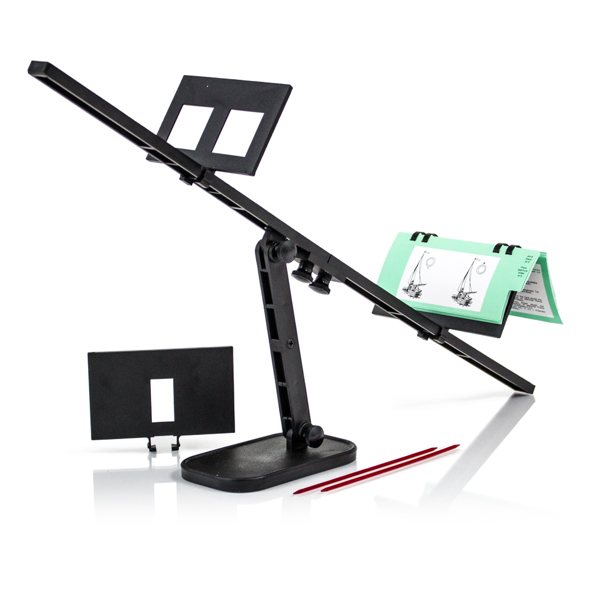

+++
title = "Vision Therapy"
description = "Physical therapy for your eyes."
aliases = ["vision-therapy", "vision_therapy"]
sort_by = "title"

[extra]
updated = 2027-01-01
site_version = 1
toc_level = 3
see_also = [
  { title = "Permalink", href = "/vision-therapy" },
  { title = "Vestibular", href = "https://vestibular.org/" },
  { title = "Vision Therapy Exercises", href = "https://aworkoutaday.com/exercises?StrengthMuscle=536870912" },
  { title = "Font Family: Optician Sans", href = "https://github.com/anewtypeofinterference/Optician-Sans" },
]
comments = [
  "Don't put any exercises here. Those should be linked to from each individual tool."
]
+++

{{ <hidden page={page} section={section} /> }}

# Vision Therapy Tools

**[Aperture Rule](/vision-therapy/aperture-rule)**
_Requires an Aperture Rule Trainer!_
: Image generator for an aperture rule trainer.

**[Arrow Chart](/vision-therapy/arrow-chart)**
: A chart of arrows for directional exercises.

**[Arrow Color Chart](/vision-therapy/arrow-color-chart)**
: A chart of colored arrows for decoding exercises.

**[Barrel Card](/vision-therapy/barrel-card)**
: ?

**[Closed/Open/Flat](/vision-therapy/closed-open-flat)**
: ?

**[Fusion Card](/vision-therapy/fusion-card)**
: ?

**[Hart Chart](/vision-therapy/hart-chart)**
: ?

**[Letter Saccades](/vision-therapy/letter-saccades)**
: ?

**[Letter Search](/vision-therapy/letter-search)**
: ?

**[Letter Tracking](/vision-therapy/letter-tracking)**
: ?

**[Line Counting](/vision-therapy/line-counting)**
: ?

**[Number Dots](/vision-therapy/number-dots)**
: ?

**[Number Grid](/vision-therapy/number-grid)**
: ?

**[Number Saccades](/vision-therapy/number-saccades)**
: ?

**[Number Search](/vision-therapy/number-search)**
: ?

**[Shape Chart](/vision-therapy/shape-chart)**
: ?

**[Shape Color Chart](/vision-therapy/shape-color-chart)**
: ?

**[Single Target](/vision-therapy/single-target)**
: ?

**[Slap Tap](/vision-therapy/slap-tap)**
: ?

**[Space Fixator](/vision-therapy/space-fixator)**
: ?

**[Spot the Match](/vision-therapy/spot-the-match)**
: ?

**[Stereo Circles](/vision-therapy/stereo-circles)**
: ?

**[Tranaglyph](/vision-therapy/tranaglyph)**
: ?

# Equipment

**Aperture Rule Trainer**

: An aperture rule trainer forces your eyes to see separate images using mechanical means.
: If a single aperture is used, your eyes are required to converge near the two images, creating a convergence demand in order to fuse the two images.
: If a double aperture is used, your eyes are required to converge distant the two images, creating a divergence demand in order to fuse the two images.

**Brock String**

: A string of beads.
: Position the first bead so it is 12 inches from the handle.
: Position the second bead so it is 5 feet from the handle.
: Position the third bead so it is 8 feet from the handle.
: > [!TIP]
  > Use an [Alpine Butterfly Loop Knot](https://www.animatedknots.com/alpine-butterfly-loop-knot) to create a back-stop for each bead threaded onto the string.

**Prism Lens**

: A triangular shaped lens that shifts the image from one eye inwards or outwards.
: **Base-In**
  Requires divergence.
  : The thick end of the lens (the base) should face towards your nose.
  : The image is shifted outwards—towards the small end of the lens (the apex).
  : - This requires your eyes to diverge and shift outwards as well to match and fuse the images.

  **Base-Out**
  Requires convergence.
  : The thick end of the lens (the base) should face away from your nose.
  : The image is shifted inwards—towards the small end of the lens (the apex).
  : - This requires your eyes to converge and shift inwards as well to match and fuse the images.

# Testimonials

>> Wow this is so gracious of you bless you. 
>> I hope you are blessed with whatever you desire in life. 
>> This is such a huge resource for those of us that can’t afford VT.
###### DG

>> Thank you very much for this. 
>> 10 months postpartum in an area with no VT clinic, this is a LIFESAVER. 
>> 🩶🩶 THANK YOU!
###### OC

>> Oh my gosh thank you so much ❤️❤️❤️
###### SSV
