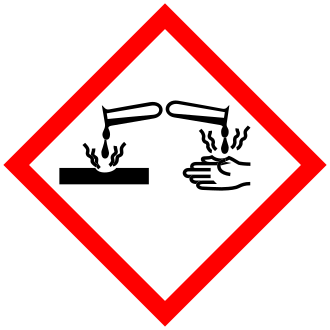
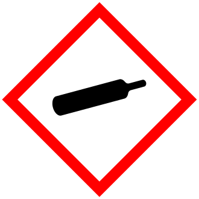
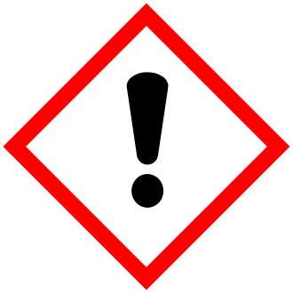
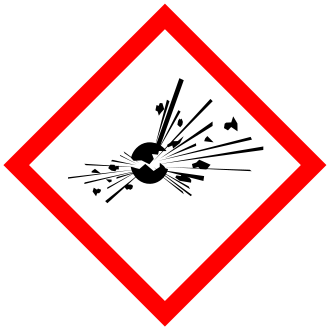
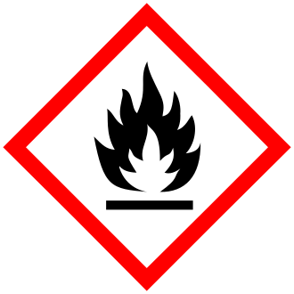
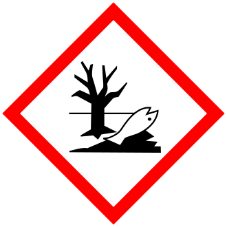
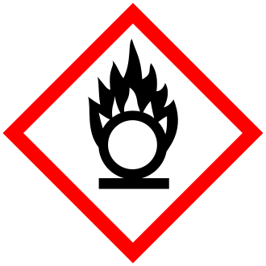
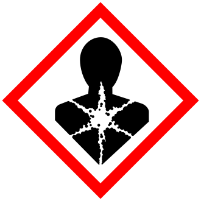
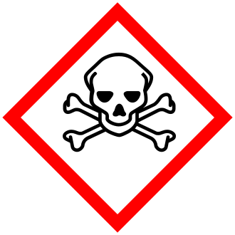

+++
title = "Chemicals"
description = ""
sort_by = "title"
weight = 3000

[extra]
updated = 2026-01-01
see_also = []
+++

{{ <hidden page={page} section={section} /> }}

**[ph Buffer Solution](https://www.fishersci.com/shop/products/buffer-solution-ph-7-00-color-coded-yellow-certified-fisher-chemical-5/SB107500)**
: **Disposal**
  : ?

# GHS Pictograms

**Corrosive**

: ?

**Compressed**

: ?

**Irritant**

: ?

**Explosive**

: ?

**Flammable**

: ?

**Pollutant**

: ?

**Oxidizer**

: ?

**Hazard**

: ?

**Toxic**

: ?
